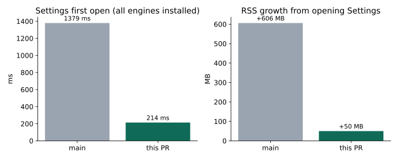
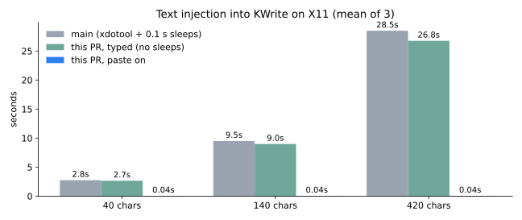
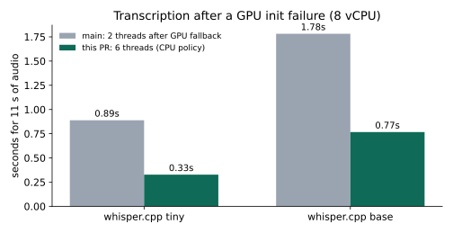
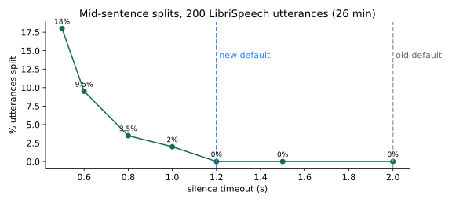

# Performance benchmarks

Before and after numbers for the performance pass in
[#968](https://github.com/VocaHQ/vocalinux/pull/968). "main" is the code before
that PR. All runs used the same box: 8 vCPU Intel Xeon Platinum 8559C, Python
3.13, pywhispercpp 1.5.1, X11.

## Settings first open

The Settings dialog used to import every installed engine package (Vosk,
OpenAI Whisper, faster-whisper) just to see whether it was installed. With all
optional engines installed, the first open took 1.38 s and the process kept an
extra 606 MB for the rest of its life. Probing with `importlib.util.find_spec`
brings that down to 214 ms and 50 MB.

## Text injection on X11

Measured by injecting text into KWrite through `TextInjector.inject_text`,
mean of 3 runs. Dropping the 0.1 s sleep after every 20 characters saves
about 2 s per 420 characters. Turning on Settings > "Paste long dictations"
sends text of 30 or more characters through the clipboard, which takes about
40 ms at any length; the previous clipboard content is restored afterwards.
Typing speed itself is set by xdotool's per-key delay, so absolute typed
times vary by machine.

## whisper.cpp after a GPU init failure

When Vulkan or CUDA fails to initialise, the CPU fallback used to keep the
GPU thread count (cores / 4, so 2 here) instead of the CPU policy
(cores - 2, capped at 8, so 6 here). Times are for an 11 s clip.

## Silence timeout

200 LibriSpeech dev-clean utterances (5 per speaker, 26 min of audio) were
replayed through the same segmentation `_record_audio` uses: 1024-sample
chunks, Silero VAD at the default sensitivity, and a split whenever silence
exceeds the timeout. Below 1.2 s some sentences get cut in two at a natural
pause; at 1.2 s none were. The default is now 1.2 s instead of 2.0 s, so each
dictation finishes 0.8 s sooner. Read speech pauses less than live dictation,
so raise the timeout in Settings if you pause mid-sentence to think.

## Where the time goes

On an 11 s utterance with the tiny model, the Python code around the
transcription took 0.3 ms of a 389 ms call; the rest is native whisper.cpp.
A standalone `whisper-cli` built from the same whisper.cpp commit was no
faster, so rewriting the app in another language would not speed up
transcription.
